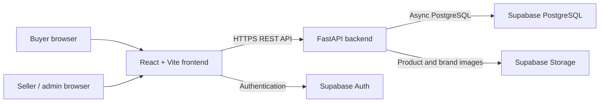

# Catálogos S.A.S.

**A full-stack SaaS platform for independent sellers to publish product catalogs and receive orders.** Built and deployed as a production web application.

[Open the application](https://catalogos-s-a-s.vercel.app/) · [API health](https://catalogos-s-a-s.onrender.com/health) · [GitHub repository](https://github.com/Eliebmola/Catalogos-S.A.S)

Catálogos S.A.S. helps sellers create shareable storefronts without requiring buyers to create an account. Sellers manage products, images, categories, customer orders, subscriptions, and support from one dashboard. Buyers browse a seller's catalog, add products to a cart, submit an order, and can continue the conversation with the seller through WhatsApp.

## Project highlights

- Built and deployed a production full-stack application, with the React web client on Vercel and the FastAPI service on Render.
- Designed a modular REST API with FastAPI, Pydantic, async SQLAlchemy, and PostgreSQL on Supabase.
- Implemented Supabase authentication, JWT verification, seller/admin authorization, and catalog ownership checks.
- Developed catalog, product, image, category, seller profile, shopping cart, and order workflows.
- Added an internal seller-to-admin support inbox and an administrator panel for manual subscription management.
- Implemented privacy consent, seller guidance, multi-language UI, rate limiting, request-size limits, and production CORS configuration.
- Kept credentials out of the repository; environment templates document which settings belong in each hosting provider.

## Architecture



## Technology

| Area | Stack |
| --- | --- |
| Frontend | React, TypeScript, Vite, Tailwind CSS, React Router, Supabase JS |
| Backend | Python, FastAPI, Pydantic, SQLAlchemy async, asyncpg |
| Data and identity | Supabase PostgreSQL, Auth, Storage |
| Deployment | Vercel (frontend), Render (API), GitHub (source) |

## Repository structure

```text
backend/     FastAPI application, SQLAlchemy models, SQL scripts, tests
frontend/    React + Vite application and Vercel SPA routing config
```

## Run locally

1. Create local environment files from `backend/.env.example` and `frontend/.env.example`. Keep real `.env` files out of Git.
2. Start the backend from `backend/`:
   ```bash
   python -m venv .venv
   # Activate the environment, then:
   pip install -r requirements-dev.txt
   uvicorn app.main:app --reload
   ```
3. Start the frontend from `frontend/`:
   ```bash
   npm ci
   npm run dev
   ```

The local frontend runs at `http://localhost:5173`; the local API runs at `http://localhost:8000`.

## Production configuration

- Vercel **Root Directory**: `frontend`; build: `npm run build`; output: `dist`.
- Render **Root Directory**: `backend`; build: `pip install -r requirements.txt`; start: `uvicorn app.main:app --host 0.0.0.0 --port $PORT`.
- Set `VITE_API_URL` to the public API origin and `CORS_ORIGINS` to the exact HTTPS frontend origin(s).
- Set database credentials and Supabase service-role credentials only in backend hosting secrets. Browser variables prefixed with `VITE_` are public at runtime; never place private keys there.
- Apply the SQL scripts in `backend/supabase/` to the Supabase project before using the related features.

## Maintainer

**Elieb Mola** · [GitHub profile](https://github.com/Eliebmola)

---

### Resumen en español

Plataforma SaaS desarrollada y desplegada en producción para que vendedores publiquen catálogos y reciban pedidos sin exigir que el comprador cree una cuenta. Incluye gestión de productos, imágenes y categorías, carrito, bandeja de pedidos, soporte interno y administración manual de suscripciones. Frontend React/TypeScript en Vercel, API FastAPI en Render y PostgreSQL/Auth/Storage en Supabase.
